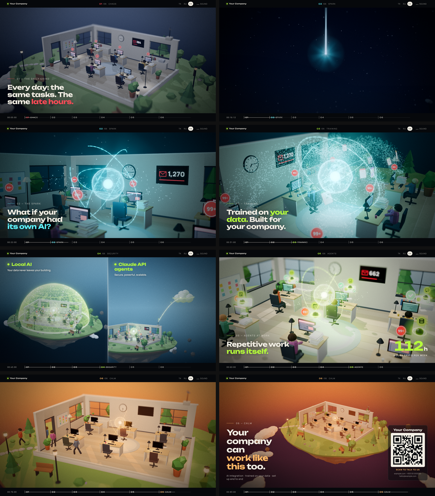

# A Day in a Company — expo booth film

A scroll-driven 3D short film for a tech-expo booth. A floating miniature office
goes from **chaos → spark → training → security → agents at work → calm**, with
a glowing **AI Core** as the protagonist. Everything is generated in code (models,
textures, sound), so it runs **fully offline** from a static folder.



```
01 Chaos      cold evening, paper piles up, clock spins, red badges, inbox climbs
02 Spark      the office darkens, a light falls from the sky and becomes the Core
03 Training   documents lift off and stream into the Core as GPU particles
04 Security   split screen: Local AI shield dome  |  one encrypted beam to Claude API agents
05 Agents     the Core splits into six drones that clear each desk; hours-saved counter
06 Calm       golden hour, people leave on time, lights dim, final screen + QR code
```

---

## Quick start

Requires Node.js 18+ (only for building; the result is plain static files).

```bash
npm install
```

```bash
npm run dev        # development server with hot reload → http://localhost:5173
```

```bash
npm run build      # type-check + production build into dist/
```

```bash
npm run preview    # serve dist/ locally → http://localhost:4173
```

`dist/` is self-contained (fonts, code, everything). Copy it to the booth PC and serve it
with any simple static server, for example:

```bash
npx serve dist        # or: python -m http.server 8080 --directory dist
```

> Opening `dist/index.html` directly via `file://` is blocked by browsers for ES modules —
> always use a local server (any of the above works offline).

---

## Controls & URL options

| Input | Action |
| --- | --- |
| Scroll / swipe | scrub the film (smooth scroll) |
| `→` `↓` `Space` `PageDown` | next scene |
| `←` `↑` `PageUp` | previous scene |
| `Home` | back to the start |
| `K` | toggle kiosk (autoplay) mode |
| `F` | toggle full screen |
| `M` | toggle sound |
| Progress-bar markers | jump to a scene |

| URL parameter | Effect |
| --- | --- |
| `?mode=kiosk` | start in kiosk mode (autoplay loop) |
| `?lang=tk` / `ru` / `en` | force a language (otherwise last choice, then `defaultLanguage`) |
| `?quality=low` / `medium` / `high` | force a quality tier (disables auto fallback) |
| `?reduced` | simulate `prefers-reduced-motion` |
| `?debug` | FPS, tier, draw calls, GPU name overlay |
| `?t=42` | freeze the film at 42 s (screenshots, review) |

### Kiosk mode

`?mode=kiosk` (or press `K`) plays the story as an ~84 s film, holds the final screen,
fades to black and loops forever. Any touch, scroll, click or key press hands control to the
visitor (scroll mode, continuing from the current moment). After `kiosk.idleResumeSeconds`
(30 s) without input, autoplay resumes from where the visitor left it.

### Running full screen on the booth PC

Start the static server (see above) on the booth PC, then launch Chrome in kiosk mode.

**Windows** (shortcut target or a `.bat` file):

```bat
"C:\Program Files\Google\Chrome\Application\chrome.exe" --kiosk --start-fullscreen --autoplay-policy=no-user-gesture-required --disable-pinch --overscroll-history-navigation=0 --noerrdialogs --disable-session-crashed-bubble --disable-infobars "http://localhost:8080/?mode=kiosk"
```

**macOS** (Terminal):

```bash
open -na "Google Chrome" --args --kiosk --start-fullscreen --autoplay-policy=no-user-gesture-required --disable-pinch --overscroll-history-navigation=0 --noerrdialogs --disable-session-crashed-bubble "http://localhost:8080/?mode=kiosk"
```

Exit Chrome kiosk with `Alt+F4` (Windows) or `⌘Q` (macOS).

Booth tips:
- Disable OS sleep / screensaver and set the TV to "game" or "PC" mode (lower latency, no motion smoothing).
- Prefer the PC's dedicated GPU (Windows: *Settings → Display → Graphics → Chrome → High performance*).
- Sound is off by default. With `--autoplay-policy=no-user-gesture-required` you can press `M`
  once after launch to enable the ambient soundtrack.

---

## Editing content

### Configuration — `src/config.ts`

| Key | Meaning |
| --- | --- |
| `companyName` | Top bar + final screen |
| `logoPath` | Optional logo file in `public/` (e.g. `'logo.svg'`); empty = company name as text |
| `brandAccentColor` | The trained Core, agents, highlights (hex) |
| `contactUrl` | Encoded into the QR code (generated locally, no network) |
| `contactLine` | Short line under the QR code |
| `hoursSavedPerWeek` | **Placeholder** — the hours-saved counter in scene 5 |
| `defaultLanguage` | `'tk'` by default |
| `kiosk.*` | End hold, loop fade, idle resume time, playback speed, language cycling per loop |
| `scrollLengthVh` | Scroll length of the story (viewport heights) |

### Texts — `src/i18n/{tk,ru,en}.json`

All copy lives in these three files (headlines, scene kickers, progress-bar names,
split-screen labels, counter label, final screen). Wrap words in `*asterisks*` to
highlight them in the scene colour, e.g. `"Your data. *Your rules.*"`.

⚠️ `tk.json` is a draft translation — **a native Turkmen speaker should proofread it**
before the expo (see the `_comment` at the top of the file).

### Timing

Scene lengths are in `src/core/timeline.ts` (`D = [13, 11, 14, 15, 15, 16]` seconds).
Every animation is written relative to its scene start (`S(sceneIndex, offset)`), so
retiming a scene moves everything inside it. Camera keys are in
`src/render/CameraRig.ts`, light/colour moods in `src/render/Atmosphere.ts`.

---

## Stack — and why

| Choice | Why |
| --- | --- |
| **Three.js** | Mature WebGL engine; full control of custom shaders, instancing and render targets with a small footprint. No model files needed — every mesh is procedural. |
| **postprocessing** (pmndrs) | Merges effects into few full-screen passes (fast); HDR half-float pipeline, high-quality mip-map bloom, ACES tone mapping. Two custom effects are added on top: an HDR-safe tilt-shift (the miniature look) and a colour grade with vignette + film grain. |
| **Lenis** | Smooth, inertia-based scrolling that feels like a film scrubber, with native touch on phones. |
| **qrcode** | Generates the QR code SVG locally from `contactUrl` (offline). |
| **@fontsource/unbounded + manrope** | Distinctive wide display face + clean text face; both include Latin-Extended (Turkmen ä ç ň ö ş ü ý ž) and Cyrillic subsets, bundled locally. |
| **Vite + TypeScript** | Fast builds, strict types, outputs a relative-path static `dist/`. |
| **Web Audio API** | Ambient pad, reverb, ticks and cue blips are synthesized — no audio files, no licensing. |

No CDNs, no runtime network requests.

---

## Architecture

```
src/
  config.ts              ← booth configuration (edit me)
  main.ts                ← bootstrap + main loop
  core/
    timeline.ts          ← THE master timeline: scenes, durations, cues
    Playback.ts          ← scroll driver (Lenis) and kiosk driver (autoplay/loop/idle)
    math.ts              ← easing, ramps, keyframe Track (Catmull-Rom / smooth)
    quality.ts           ← GPU tiers + runtime FPS governor (auto fallback)
  scenes/
    state.ts             ← WorldState: everything the picture depends on
    s1Chaos.ts … s6Calm.ts ← each scene's choreography: f(t) → state
    index.ts             ← evaluate(t): reset → apply all scenes in order
  render/
    Stage.ts             ← renderer, cameras, post chain
    SplitRenderPass.ts   ← two-camera split screen (animated wipe)
    effects.ts           ← tilt-shift + colour grade effects
    CameraRig.ts         ← camera keyframes, aspect-aware framing, lens shift
    Atmosphere.ts        ← lights, sky, stars, fog and per-moment colour grade
  world/
    builder.ts           ← merges vertex-coloured primitives into one mesh (+ fake AO)
    Island.ts Office.ts Workers.ts Papers.ts Billboards.ts textures.ts layout.ts World.ts
  fx/
    AICore.ts            ← the protagonist (plasma shader, halo, rings, light, shockwave)
    DataStream.ts        ← training particles (GPU, curved paths)
    DocCards.ts          ← documents that dissolve into data
    Dome.ts Beam.ts Drones.ts glsl.ts
  ui/  Hud.ts WordReveal.ts   ← letterbox UI, split-text headlines, final screen
  audio/ Sound.ts             ← synthesized soundtrack
  i18n/  tk.json ru.json en.json index.ts
```

**One master timeline.** Playback only produces a film time `t`. Every frame
`evaluate(t)` rebuilds the `WorldState` from scratch (each scene writes the values it
owns), then the world, camera, lights and HUD render that state. Headline word reveals
are driven by `t` too. So scroll scrubbing (forwards *and* backwards), kiosk autoplay
and the `?t=` freeze all show exactly the same frames, and nothing is animated twice.

### Performance

- Static office + island are merged into a couple of vertex-coloured meshes (1–2 draw calls).
- Workers, papers, badges, task cards, drones, document cards, clouds and rocks are `InstancedMesh`es.
- Particles (≈26 k for the training stream) are animated entirely in vertex shaders.
- Typical frame: ~50–110 draw calls including the shadow pass.
- Pixel budget per tier (4K TVs are rendered at ≈1.24× 1440p and upscaled; grain and bloom hide it).
- Tiers: `high` (MSAA 4×, 2048 shadows, tilt-shift, full particles), `medium`, `low`
  (no shadows/tilt-shift, 28 % particles, 720p budget). Starts from a GPU guess, then the
  FPS governor lowers resolution and tier if the average stays under ~47 fps.
- Nothing is allocated per frame in the hot paths and every GPU resource is created once,
  so the kiosk loop can run for hours. DOM updates are cached (only changed values touch the DOM).

### Accessibility / reduced motion

With `prefers-reduced-motion` the camera's handheld drift, smooth-scroll inertia and
grain flicker are disabled and headlines fade instead of sliding.
# setir_expo_ai_ads
